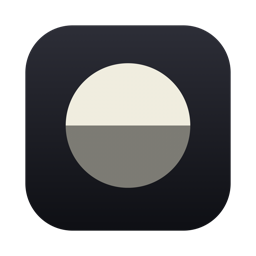

<p align="center">
  
</p>

<h1 align="center">DimWallpaper</h1>

<p align="center">macOS 原生菜单栏工具：桌面壁纸自动压暗 + 后台专注遮罩（类 HazeOver），保留前台应用高亮，支持菜单栏/Dock 独立压暗，不修改壁纸文件与显示硬件。</p>

<p align="center">
  <a href="https://github.com/xxkingstuggle/dim-wallpaper/releases/latest"></a>
  
  
  
</p>

<p align="center">
  <a href="https://github.com/xxkingstuggle/dim-wallpaper/releases/latest">下载 Release (v1.0.0)</a> ·
  <a href="https://myzjx.com/software/dim-wallpaper/">项目概览</a> ·
  <a href="https://myzjx.com/posts/dim-wallpaper-macos-desktop-overlay/">工程手记</a> ·
  <a href="https://github.com/xxkingstuggle/dim-wallpaper/issues">问题反馈</a>
</p>

原生 Swift + AppKit + SwiftUI 编写，零第三方依赖，无常驻守护进程，仅驻留一个菜单栏图标。

## 原理

所有调暗均通过**无边框鼠标穿透 `NSWindow`** 合成实现，**不调用任何硬件 Gamma/色表/亮度修改 API，无需录屏或辅助功能权限**：

### 1. 壁纸调暗层（Desktop Layer）
在每个显示器上铺一层调光遮罩，窗口层级严格落在
`CGWindowLevelForKey(.desktopWindow) + 1`（位于壁纸之上、严格低于 `CGWindowLevelForKey(.desktopIconWindow)` 桌面图标层）：

- 应用窗口完全不受影响（不透明白窗实测：开关前后像素完全相同）
- 菜单栏和 Dock 是半透明材质，会透出背后的壁纸，所以壁纸变暗时它们看起来也会略暗一点——这是材质特性，不是被盖住
- 不需要修改壁纸文件，也不碰 `com.apple.desktop` / wallpaper 数据库
- 暂停或处于浅色待命时，淡出完成后自动 `orderOut` 卸载遮罩窗口，避免空闲占用 WindowServer 合成缓冲
- 监听系统外观变化、显示器热插拔、休眠唤醒与空间切换并做短窗防抖，支持多显示器逐屏独立豁免
- `collectionBehavior = [.canJoinAllSpaces, .stationary, .ignoresCycle, .fullScreenAuxiliary]` 并开启 `canHide = false`：切 Space 或隐藏应用时不丢失覆盖

### 2. 专注遮罩层（Focus Mode）
独立于壁纸调暗层，将前台窗口之外的后台应用压暗以减少视觉干扰（两者可单独或叠加为「双重沉浸」使用）：

- **Z 序精确锚定**：通过只读 `CGWindowListCopyWindowInfo`（跳过自进程、非标准层及微小辅助窗）并按主屏高度翻转 CG→AppKit 坐标，在「当前前台应用」模式下锚定最前连续窗口组底部，在「仅最前单窗口」模式下锚定最前单窗正下方，避免夹层窗口误亮
- **菜单栏 / Dock 零重叠分条压暗**：默认保留菜单栏与 Dock 原色；开启「压暗顶部菜单栏」或「压暗程序坞 Dock」时，按 `screen.frame` 与 `visibleFrame` 将主遮罩与顶部菜单栏条（`statusBar + 1`，严格低于 `popUpMenu`）、底/左/右 Dock 条（`dock + 1`，严格低于 `mainMenu`）做**无重叠零死角分割**，并自动扣减伸入 Dock 区的前台窗口轮廓，避免双重压暗与遮挡下拉菜单
- **自进程保活与按应用豁免**：打开 DimWallpaper 控制中心、Spotlight 或控制中心时维持上一外部前台应用目标，方便实时拖动滑杆预览；支持一键将当前外部应用加入豁免名单自动暂停压暗
- **零空转回收**：关闭专注遮罩、命中豁免应用或息屏时停止轮询并将专注遮罩窗口 `orderOut` + `close` 释放

> 为什么不做「生成一张调暗的图再 setDesktopImageURL」：那会把用户的壁纸换成另一份文件，
> 系统设置里的壁纸条目会被改写，换壁纸后还得重新同步。叠加窗口方案完全不动系统状态。

## 用法

菜单栏图标：

| 图标 | 含义 |
|---|---|
| ✨🌙 | 双重沉浸（壁纸调暗 + 专注遮罩同时生效） |
| ⌖ | 仅专注遮罩生效 |
| 🌙 | 深色模式，壁纸已调暗 |
| ☀️ | 浅色模式（或已关闭深色限制），保持原色 |
| 🚫 | 已暂停 |

- **左键点击状态栏图标**：弹出原生毛玻璃控制中心，顶部提供双模式快捷胶囊与双层实时桌面预览（壁纸、后台窗、前台高亮窗、菜单栏与 Dock），下方分为「壁纸调暗 / 专注遮罩 / 通用与热键」三个标签页：
  - **壁纸调暗**：5%–80% 连续滑杆、快捷预设（轻柔 25% / 专注 45% / 深夜 65% / 极暗 80%）、色温滤镜（中性黑 / 暖夜 / 深蓝夜）、仅深色生效、逐显示器独立开关
  - **专注遮罩**：5%–85% 后台压暗滑杆与预设（轻柔 25% / 专注 45% / 沉浸 65% / 深邃 85%）、色调（跟随壁纸 / 中性黑 / 暖夜 / 深蓝夜）、菜单栏与 Dock 独立开关及一键预设（保留菜单栏与 Dock / 压暗全部）、聚焦粒度（前台应用 / 最前单窗）、多屏策略（副屏同步压暗 / 仅活跃屏幕）、过渡速度（柔和 / 灵敏 / 立即，自动遵循「减弱动态效果」）及当前外部焦点应用一键豁免
  - **通用与热键**：双零权限 Carbon 全局热键（壁纸默认 `⌃⌥⌘D`、专注默认 `⌃⌥⌘F`，兼容保留已保存旧快捷键）、登录项状态与退出；完整适配浅/深色与「降低透明度」降级
- **右键（或 Control + 左键）点击状态栏图标**：弹出极速菜单（壁纸调暗开关/预设、专注遮罩开关、同时压暗菜单栏与 Dock、聚焦范围与专注强度预设、登录项、`⌘Q` 退出）。

设置用 `UserDefaults` 保存在 `~/Library/Preferences/local.zjx.DimWallpaper.plist`。

## 安装与构建

### 方式一：从 Releases 下载预编译包

1. 前往 [GitHub Releases (v1.0.0)](https://github.com/xxkingstuggle/dim-wallpaper/releases/tag/v1.0.0) 下载 `DimWallpaper-1.0.0-macOS.zip`（可对照 `SHA256SUMS.txt` 校验）。
2. 解压后将 `DimWallpaper.app` 移入 `~/Applications` 或 `/Applications` 并打开。

### 方式二：从源码构建

```bash
git clone https://github.com/xxkingstuggle/dim-wallpaper.git
cd dim-wallpaper
swift test
./build.sh
cp -R dist/DimWallpaper.app ~/Applications/
open ~/Applications/DimWallpaper.app
```

首次启动会自动注册登录项。如果系统提示需要确认，去
「系统设置 → 通用 → 登录项与扩展」允许 `DimWallpaper.app`。

## 诊断

```bash
~/Applications/DimWallpaper.app/Contents/MacOS/DimWallpaper --status
# enabled=true intensity=0.4 darkOnly=true tint=neutral hotKeyEnabled=true focusEnabled=false focusIntensity=0.45 focusScope=frontApplication dimMenuBar=false dimDock=false focusHotKeyEnabled=true displays=1 loginItemStatus=1
# loginItemStatus: 0=notRegistered 1=enabled 2=requiresApproval 3=notFound

# 输出完整 JSON（含在线显示器列表、壁纸与专注遮罩完整参数、双快捷键与隔离 suite 信息）
~/Applications/DimWallpaper.app/Contents/MacOS/DimWallpaper --status-json

# 隔离沙箱运行参数（不触碰日用偏好与登录项）
dist/DimWallpaper.app/Contents/MacOS/DimWallpaper \
  --defaults-suite local.zjx.DimWallpaper.sandbox \
  --no-login-item \
  --allow-multiple-instances
```

## 卸载

先在菜单里取消「开机自动启动」（登录项由 `SMAppService` 托管，直接删 App 会在登录项里留下失效条目），再退出应用、将 `~/Applications/DimWallpaper.app` 移入废纸篓，并清理偏好设置：

```bash
osascript -e 'quit app "DimWallpaper"'
defaults delete local.zjx.DimWallpaper
```

## 环境

- macOS 27.0.1 / Xcode 27 / Swift 6.4，arm64
- 最低支持 macOS 13（`SMAppService` 要求）

## 已验证（2026-10-24，macOS 27.0.1 / 单显示器）

截图逐像素采样，采样点在纯壁纸区域：

- 深色模式（强度 40%）：桌面亮度 0.929 → 0.557
- 浅色模式：保持 0.929
- 反复切换深浅色，叠加层 alpha 每次都正确跟随（0 ⇄ 0.40）
- 菜单栏、Dock、应用窗口的采样亮度在开关前后不变
- 开机启动项注册成功（`loginItemStatus=1`），Launch Services 已索引
- 重复 `open` 只保留一个实例
- 菜单可见、状态条目正常出现（开启前后对比截图确认）

## 已验证（2026-11-25，`1.1.0` 分支隔离沙箱真机 / 双显示器）

在 `TYPEC`（`1920×1080 @2x`）+ `内建视网膜显示器`（`1470×956 @2x`）双屏环境下通过 `--defaults-suite` + `--no-login-item` + `--allow-multiple-instances` 隔离实测（未触碰日用实例与偏好）：

- `swift test` 核心纯逻辑单测 7/7 通过（`0.005s`）；`./build.sh` 生成 `dist/DimWallpaper.app`，`codesign --verify --deep --strict` 通过，`AppIcon_1024.png` 精确为 `1024×1024`
- `--status` 与 `--status-json` 正确输出隔离 suite、双屏元数据与色温/热键字段
- 激活态（`enabled=true, darkOnly=false, intensity=0.45`）：`CGWindowListCopyWindowInfo` 实测双屏各挂载 1 层遮罩，`kCGWindowLayer = -2147483622`（严格介于 `.desktopWindow = -2147483623` 与 `.desktopIconWindow = -2147483603` 之间），alpha `0.45`；连续 3 次 `ps` 采样空闲 **平均 CPU `0.00%`、平均 RSS `75.3 MB`**
- 逐屏独立豁免（豁免 `id=3` 外接屏）：WindowServer 在屏遮罩窗口精确缩减为 `1` 个（仅内建屏 `1470×956`）
- 暂停态（`enabled=false`）：`CGWindowListCopyWindowInfo(.optionOnScreenOnly)` 实测在屏桌面遮罩窗口为 `0`，确认 `orderOut` 释放 WindowServer 合成缓冲，新增崩溃日志为 `0`
- 毛玻璃控制中心离屏 2× 快照（`324×674@2x`，浅色与深色模式）目视验收通过，分层桌面预览、预设胶囊、色温分段、双屏开关与 `⌥⌘D` 键帽无裁切无重叠

## 已验证（2026-11-26，v2 专注遮罩双显示器 WindowServer 动态实测）

在 `TYPEC`（`1920×1080 @2x`，含底部 75pt Dock 与顶部 30pt 菜单栏）+ `内建视网膜显示器`（`1470×956 @2x`，顶部 32–33pt 刘海菜单栏）双屏环境下，使用独立 `--defaults-suite` 与 CLI 诊断覆盖参数隔离实测（0 硬件显示配置 API）：

- `swift test` 全量核心单测 **16/16 通过**（`0.008s`）；单模块 `swiftc -typecheck -warnings-as-errors -swift-version 6` 0 警告 0 报错；`./build.sh` 产物 `dist/DimWallpaper.app` 通过 `codesign --verify --deep --strict`
- **冷启动非 `.regular` 瞬态进程免疫**：实测当前台为 `com.apple.UserNotificationCenter`（`activationPolicy != .regular`）时，自动穿透回退并锚定至顶层标准窗口 `ChatGPT`（`win#=391, layer=0`）
- **场景 A（保留菜单栏与 Dock，`--focus-enabled true --dim-menubar false --dim-dock false`）**：WindowServer 实测挂载 2 层桌面遮罩（`layer=-2147483622`）+ 2 层专注主遮罩（`layer=0, alpha=0.45`）、`0` 个菜单栏条（`layer=26`）、`0` 个 Dock 条（`layer=21`）；主屏专注遮罩（`idx=8, win#=798`）严格排在顶层外部窗 `ChatGPT`（`idx=7, win#=391`）下方；`SIGTERM` 退出后在屏残留窗口为 `0`
- **场景 B（压暗全部含菜单栏与 Dock，`--focus-enabled true --dim-menubar true --dim-dock true`）**：WindowServer 实测同时挂载 2 层桌面遮罩（`layer=-2147483622`）、2 层专注主遮罩（`layer=0`）、2 条菜单栏遮罩（`layer=26`，主屏 `30pt` / 内建屏 `33pt`）与 1 条主屏 Dock 遮罩（`layer=21, 75pt`）；主屏专注主遮罩（`idx=11`）严格排在 `ChatGPT`（`idx=10`）下方；全部 5 个专注遮罩窗口两两交集面积 **`0.0000`**（零重叠无黑带）；退出后残留窗口为 `0`
- **平滑热更新常驻实例**：旧用户偏好完整保留（`enabled=true, intensity=0.0537, darkOnly=false, hotKey=⌥⌘D, loginItemStatus=1`），新版专注默认就绪（`focusEnabled=false, focusHotKey=⌃⌥⌘F`），常驻态 3 次采样空闲 **CPU `0.0%`、RSS `73.0 MB`**

未实测：双热键 `⌃⌥⌘D`/`⌃⌥⌘F` 真实键盘跨应用触发、多应用连续手动切换动画观感、通知中心覆盖、休眠唤醒后物理热插拔外接屏、状态栏真实鼠标左右键手点及「降低透明度」系统开关实机切换。

## 开源许可

采用 [MIT License](LICENSE) 开源。
